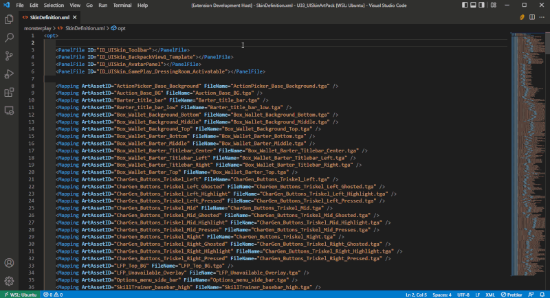
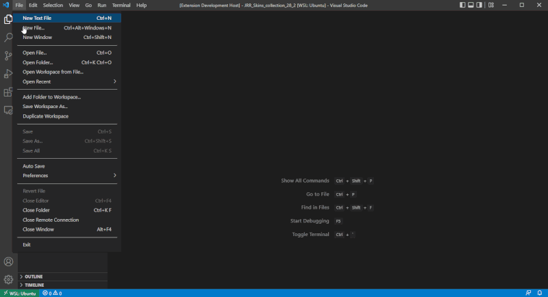
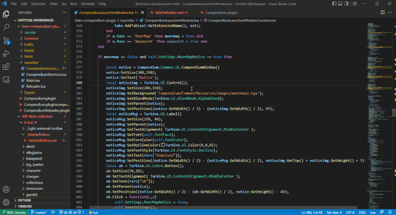
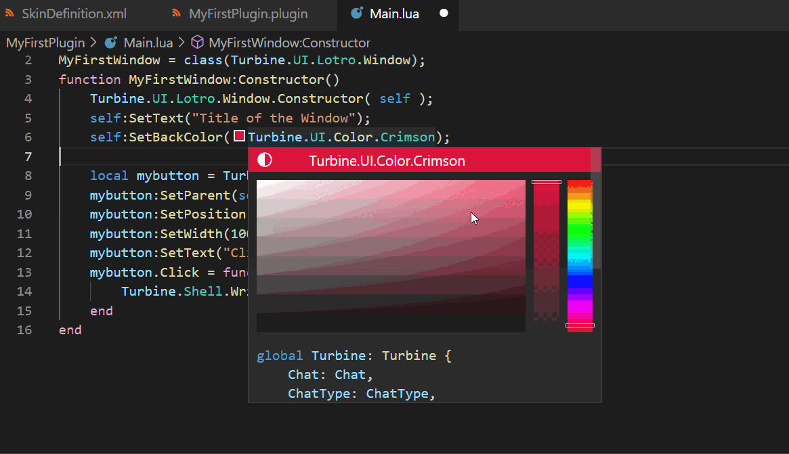
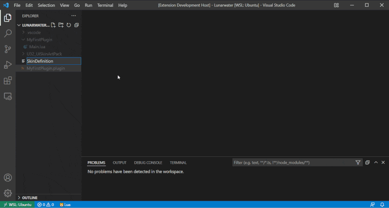
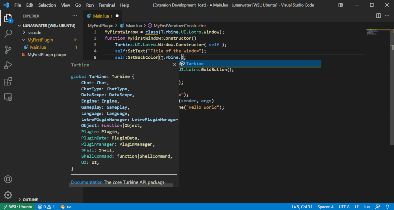

# Change Log

## [Unreleased]
- Improvement: Lua API documentation regenerated from the SSG Update 49 documentation (links now point to `lotro-api-docs/U49`)
- Improvement: new U49 UI scaling API: `Window:GetScale/SetScale`, `Get/SetScalingOriginPoint`, `Get/SetUIScalingGroup`, `RegisterForGlobalScaling/UnregisterForGlobalScaling`, `Window.UIScaleChanged` event, `Display.GetUIGroupScale`, `Plugin:GetUsesGlobalScaling` and the `UIScalingGroupType` enum
- Improvement: `Control:AttachEdges/GetEdgeAttachments` and the `EdgeAttachmentType` enum
- Improvement: minimum/maximum size methods are now on `Control` (they were only on `Window` in U25)
- Improvement: documented `BrawlerAttributes` (`GetStance`, `StanceChanged`) and `MarinerAttributes` (`GetBalance`, `BalanceChanged`); removed the hand-written Mariner stub
- Fix: `ShellCommand:Execute` is annotated as `(command, argumentText)`, matching how the game calls it (the documentation lists only `argumentText`)
- Fix: added the `Attributes.WardenGambit` enum (`Spear`, `Shield`, `Fist`, `Javelin`), which has a documentation page but was missing
- Fix: added the `Attributes.BrawlerStance` enum (`None`), which is in the game client but not in the documentation
- Fix: added enum members that exist in the game client but not in the documentation: `Class.Brawler`, `ItemCategory.Brawler`, `Equipment.Bridle`, `Lotro.ShortcutType.Emote`, `Lotro.ShortcutType.Undef`
- Chore: `ripdocs.pl` takes the documentation folder/version from `LOTRO_DOC_DIR` / `LOTRO_DOC_VERSION` and writes enums without known values as `number` fields
- Chore: `ripdocs.pl` finds `Attributes` enum pages automatically instead of using a fixed list, and adds enums and enum members that are only in `TurbineDump.json` (marked "Not in the SSG documentation")
- Chore: `Class.Mariner`, `ItemCategory.Beorning`, `ItemCategory.Mariner` and `Race.RiverHobbit` now come from `TurbineDump.json` and were removed from `manual-changes.txt`

## [1.0.18] - 2026-03-29
- Fix: random import bugs experienced by people
- Improvement: added updated documentation
- Fix: fixed issue with class attributes and mount events not linking up

## [1.0.16] - 2023-06-17
### Added
- Fix: Disable diagnostics for `duplicate-set-field`
- Fix: Fix diagnostics warnings when using `class` utility to define a new class.

## [1.0.14] - 2022-11-11
### Added
- Fix: Fixed several innacuracies in the LOTRO API emmylua documentation
- Chore: Updated libraries dependencies for security
  
## [1.0.13] - 2022-06-04
### Added
- Improvement: Skinning preview speed improvements
- Improvement: Progress bar added for loading of skinning preview
- Improvement: Additional image mappings for skinning elements for better rendering
- Improvement: Addition of unofficial skinning panels & new configuration setting to activate
- Improvement: Skinning Preview panel dropdown now sorts order changed so author skin panels are first, then defaults, then unofficial (if turned on)
- Improvement: Added support for XML Entity variables
- Improvement: Added XSD schema documentation for skinning elements
- Fix: Fixed issue where images were not loading from cache and being regenerated each time.

## [1.0.12] - 2022-05-14
### Added
- Improvement: Skinning preview nearly complete
- Improvement: New Setting to keep converted TGA in skin asset folder
- Improvement: Setting to open preview Beside editor or not
- Fix: Skin is now merged with base skin definition to suppliment what is left out by author

## [1.0.11] - 2022-05-07
### Added
- Improvement: Initial work for rendering skins in a webview (work in progress)
- Improvement: Added configuration for pointing at skinning asset folder
- Improvement: display images that are ID based if they are derived from Skinning Assets.

## [1.0.10] - 2022-04-21
### Added
- Improvement: Adding hover display of images in SkinDefinition.xml files
- Improvement: Adding hover display of images in .plugin files
- Improvement: Adding hover display of images in .lua files

## [1.0.9] - 2022-04-16
### Added
- Improvement: Adding support for  `.skincompendium`, `.musiccompendium`  xml files 
- Improvement: Adding options `<StartupScript>` tag to compendium xsds
- Improvement: Adding TGA image file support dependency

## [1.0.8] - 2022-03-30
### Added
- Improvement: Adding support for deprecated lua function from 5.1
- Improvement: Adding Attributes stance enum classes
- Improvement: Adding undocumented IsA function to base Turbine.Object class
- Improvement: In editor color display and color picker for Turbine.UI.Color classes
    

## [1.0.7] - 2022-03-27
### Added
- Improvement: Added support for UI Skinning files (xml schema + snippets)
    
- Improvement: Turbine.UI.Color documentation references small images of colors.
    
- Improvement: Documented several "table" types in lotro api.
- Improvement: Documented callback functions for sorting and filtering in UI components

## [1.0.6] - 2022-03-19
### Added
- Improvement: Added more snippets for lua files
- Improvement: Hyperlinks to hosted lua documentation
- Improvement: Usage GIFs of features
- Improvement: Centralized settings to workspace

## [1.0.5] - 2022-03-16
### Added
- Fix: file association now fixed for new .plugin & .plugincompendium files
- Improvement: Adding snippets for .plugin & .plugincompendium files
- Improvement: Added snippets for lua files

## [1.0.4] - 2022-03-15
### Added
- Improvement: Constructors on extended Turbine classes are now recognized
- Improvement: .plugin files are now supported
- Improvement: .plugincompendium files are now supported

## [1.0.3] - 2022-03-14
### Added
- Improvement: better support for opening plugin root folder as workspace
- Improvement: added documentation for event arguements
- Improvement: added undocumented BankItem class & functions
- Improvement: added undocument SkillList events SkillAdded & SkillRemoved
- Fix: Correct Turbine class name collisions during class detection

## [1.0.2] - 2022-03-10
### Added
- Improvement: Fix in namespace import erroring in some instances
- Improvement: Added additional 30 functions found in dump but not HTML documentation
- Improvement: Added global variables for currently loaded plugin(s)
- Fix: Added detection of "extending" a Turbine component.  Correctly identifies typing now.

## [1.0.1] - 2022-03-09
### Added
- Improvement: added most of Turbine.Gameplay.Attributes classes
- Improvement: Undocumented Stretch mode added
- Improvement: Missing GetWearState method added to Item class
- Fix: GetMoney* functions so they return multi value returns
- Fix: import should correctly create package namespaces

## [1.0.0] - 2022-03-06
### Initial release
